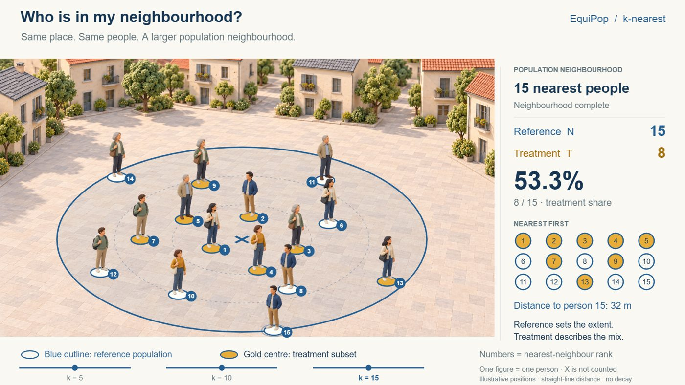
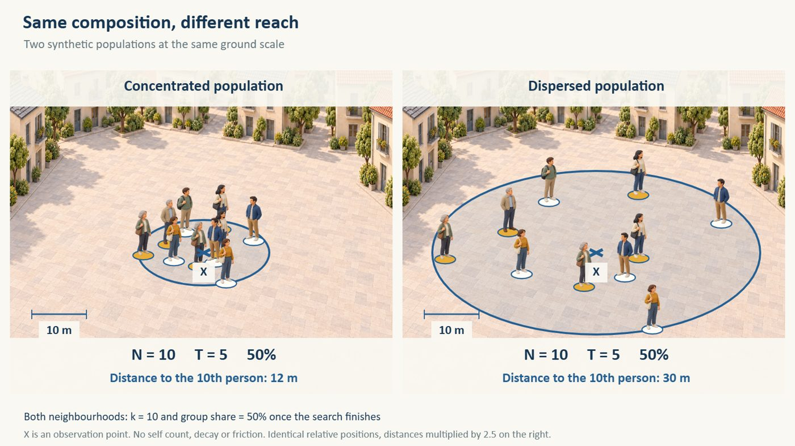

# 0. Why individual neighbourhoods

## The idea

Stand in a square and ask: who is in my neighbourhood? A map of
statistical zones answers with a line someone drew for another
purpose. EquiPop answers by counting outward from where you stand:
the nearest five people, then ten, then fifteen. In the square in
the picture, all fifteen belong to the reference population (blue),
and eight of them also belong to a group we are interested in (gold).
Gold is a subset of blue, not a second population. Among the nearest
five, all five are gold, a share of 100 %. Among the nearest ten,
seven are: 70 %. Among all fifteen, eight: 53.3 %. The search had to
reach 12, 22 and 32 metres to find them.

Nothing about the place changed between those three answers. Only
the question did: *how many* neighbours make a neighbourhood. That
number is called **k**, and the share falling as k grew is a property
of this square, not a rule. In another place it could rise. This is
the first reason for the whole approach. A neighbourhood is not a
thing that exists and waits to be measured; it is a choice of scale,
and the honest response to a choice is to make it visible and vary
it.

**Every neighbourhood becomes a variable.** Move the starting point
from the square's centre to a resident, and the same counting gives
that resident a measurement of their own surroundings. With k = 5
and the resident counted among their own neighbours, three residents
of the square get three different contexts: 5 of 5 (100 %) within
12.7 m, 3 of 5 (60 %) within 17.3 m, and 3 of 5 (60 %) within 23.4 m.
Those numbers are columns in a table, one row per person, and they
can sit beside the person's own attributes and outcomes. Two things
follow straight away. A neighbour near several residents contributes
to several contexts, so the contexts are not independent of each
other. And the reference population has to stay whole: deleting the
people whose outcome happens to be missing would change everybody
else's neighbourhood.

**Composition and reach are two different things.** In the second
picture both searches stop at ten people, five of them gold: the same
50 %. On the left the tenth person stood 12 m away; on the right,
where the same arrangement is spread 2.5 times wider, 30 m. The share
alone cannot tell a dense neighbourhood from a scattered one. EquiPop
reports both, the share and the distance the search had to travel
(`R_` and `Dist_` in the output), because a study may need either or
both.

**What k counts is a decision too.** An apartment building with 80
residents contributes 80 people. A workplace with 80 jobs contributes
80 jobs. A nearest-location rule counts each of them as one place.
"The nearest 400" means nothing until it says 400 *what*, and the
reference population (everyone, adults only, jobs, households) sets
what a share is a share of.

## What the field already knows

The problem EquiPop addresses is old. Results computed on areas
depend on how the areas were drawn, at what size and with what
borders: the **modifiable areal unit problem** (Openshaw 1984). A
person's exposure also depends on where they actually spend their
time, which no residential zone captures: the **uncertain geographic
context problem** (Kwan 2012). The response that runs through the
literature is to build a neighbourhood around each person instead of
assigning them to a zone.

Two families of these *egocentric* or *bespoke* neighbourhoods exist.
The first fixes a **distance**: everyone within 500 m, or 2 km, often
with nearer people weighted more (Reardon and O'Sullivan 2004; Lee et
al. 2008; Reardon et al. 2008). The second, EquiPop's, fixes a
**population**: the nearest k people, wherever they live (Östh, Clark
and Malmberg 2015). Fixing the count means a rural resident and a
city resident are compared on neighbourhoods of the same size in
people, while their size in metres floats; fixing the distance does
the opposite. Neither is right in general, and EquiPop computes both
(chapter 4).

Measured at many k at once, segregation turns out to have a **scale**,
and the scale is often the finding. A group can be strongly clustered
among the nearest few hundred people and much more mixed among the
nearest hundred thousand (Östh, Clark and Malmberg 2015). Isolation
also behaves in a way worth knowing before reading any result: as k
grows towards the whole region, the average share of one's own group
among one's neighbours does not fall to zero but to the group's share
of the region. A group that is 40 % of a region is exactly 40 %
isolated once k takes in the whole region. The approach has since been used
to compare neighbourhood composition across scales and over time in
Los Angeles (Clark et al. 2015) and across four European countries
with register data (Andersson et al. 2018).

Straight lines are a simplification. **EquiPop Flow** let
neighbourhoods grow along street and transport networks and slow down
at barriers, so two people the same distance apart can be near or far
depending on what lies between them (Östh and Türk 2020). Walking
effort on slopes has its own long tradition, the best known being
Tobler's hiking function (Tobler 1993). Chapters 9 and 10 build on
both.

Neighbourhoods also contain things to reach, not only people to meet.
**Accessibility** measures sum opportunities with nearer ones counting
more (Hansen 1959), and the **floating catchment** family divides
them among everyone competing for them (Luo and Wang 2003). Chapters
12 and 13 bring both onto the same footing as the neighbourhood
counts. **Time geography** adds the constraint that people must be
somewhere at certain times: what can be reached depends on the gap
between appointments and on who has to accompany whom (Hägerstrand
1970). EquiPop does not compute time-space prisms, but the question
they ask, which opportunities are feasible for this person on this
day, is the right one to keep in mind when choosing a decay or an
effort budget.

Finally, contexts are usually computed in order to be used in a
**statistical model**: an outcome for each person, the person's own
attributes, and their measured surroundings. The spatial econometrics
literature separates two mechanisms, the characteristics of
neighbours (the SLX model) and feedback through neighbours' outcomes
(SAR, and SDM for both), and warns that the second needs its own
estimators (Halleck Vega and Elhorst 2015; LeSage and Pace 2009). The
paper accompanying EquiPop's Stata commands shows why the choice of
neighbourhood matters in practice: for professional-services
employment in Dallas–Fort Worth, the share among the nearest 25,000
jobs and the share within 5 km correlate at only 0.668, and the two
differ by more than two percentage points for 37.2 % of 35,263
workplace blocks (Östh et al., submitted).

## How to read this book

The chapters follow the questions above in order. Chapter 1 runs the
first measurement on Gridby, the invented town used throughout, and
chapter 2 installs EquiPop. Chapters 3 to 8 are about the counting
itself: data in, the menu of neighbourhood definitions, counts and
shares, distributions, distance decay and the shape of the cells.
Chapters 9 and 10 replace straight lines with effort. Chapter 11
looks for clusters, and chapters 12 and 13 turn from people to
opportunities. The last chapters open EquiPop in ArcGIS Pro and in
Stata.

## Pitfalls

**A context describes surroundings; it does not explain them.** An
association between a person's outcome and their neighbourhood share
can come from the neighbourhood, from the reasons people came to live
there (residential sorting), or from both. A causal claim needs a
research design, not a better neighbourhood measure.

**Choose the scale for a reason, then vary it.** Contexts at nested
k are strongly correlated, and choosing the k that gives the smallest
p-value is a way of finding noise. State why a scale fits the
question, and report whether the result survives defensible
alternatives: another k, a radius, another decay.

**Keep the reporting sample and the reference population apart.**
The people you report results for can be a subset; the people who
make up everyone's neighbourhood should not be. And look at the
edges of the study area, where neighbourhoods are cut short by the
end of the data rather than by anything real.

## References

Andersson, E. K., Malmberg, B., Costa, R., Sleutjes, B., Stonawski,
M. J. and de Valk, H. A. G. (2018). A comparative study of
segregation patterns in Belgium, Denmark, the Netherlands and Sweden:
neighbourhood concentration and representation of non-European
migrants. *European Journal of Population* 34(2), 251–275.

Clark, W. A. V., Anderson, E., Östh, J. and Malmberg, B. (2015). A
multiscalar analysis of neighborhood composition in Los Angeles,
2000–2010: a location-based approach to segregation and diversity.
*Annals of the Association of American Geographers* 105(6),
1260–1284.

Hägerstrand, T. (1970). What about people in regional science?
*Papers of the Regional Science Association* 24, 7–21.

Halleck Vega, S. and Elhorst, J. P. (2015). The SLX model. *Journal
of Regional Science* 55(3), 339–363.

Hansen, W. G. (1959). How accessibility shapes land use. *Journal of
the American Institute of Planners* 25(2), 73–76.

Kwan, M.-P. (2012). The uncertain geographic context problem.
*Annals of the Association of American Geographers* 102(5), 958–968.

Lee, B. A., Reardon, S. F., Firebaugh, G., Farrell, C. R., Matthews,
S. A. and O'Sullivan, D. (2008). Beyond the census tract: patterns
and determinants of racial segregation at multiple geographic scales.
*American Sociological Review* 73(5), 766–791.

LeSage, J. and Pace, R. K. (2009). *Introduction to Spatial
Econometrics.* Boca Raton: CRC Press.

Luo, W. and Wang, F. (2003). Measures of spatial accessibility to
health care in a GIS environment: synthesis and a case study in the
Chicago region. *Environment and Planning B* 30(6), 865–884.

Openshaw, S. (1984). *The Modifiable Areal Unit Problem.* Concepts
and Techniques in Modern Geography 38. Norwich: Geo Books.

Östh, J., Clark, W. A. V. and Malmberg, B. (2015). Measuring the
scale of segregation using k-nearest neighbor aggregates.
*Geographical Analysis* 47(1), 34–49.

Östh, J. and Türk, U. (2020). Integrating infrastructure and
accessibility in measures of bespoke neighbourhoods. In S. Musterd
(ed.), *Handbook of Urban Segregation*, 378–394. Cheltenham: Edward
Elgar.

Östh, J. and colleagues (submitted). equipop: Individualized spatial
contexts in Stata.

Reardon, S. F. and O'Sullivan, D. (2004). Measures of spatial
segregation. *Sociological Methodology* 34, 121–162.

Reardon, S. F., Matthews, S. A., O'Sullivan, D., Lee, B. A.,
Firebaugh, G., Farrell, C. R. and Bischoff, K. (2008). The geographic
scale of metropolitan racial segregation. *Demography* 45(3),
489–514.

Tobler, W. (1993). *Three Presentations on Geographical Analysis and
Modeling.* NCGIA Technical Report 93-1. Santa Barbara: National
Center for Geographic Information and Analysis.

*The two drawings come from the EquiPop teaching presentation
(October 2026). They are teaching scenes, not data, and they are the
only figures in this book without a script; every other figure is
drawn by a script in examples/ and can be redrawn.*
